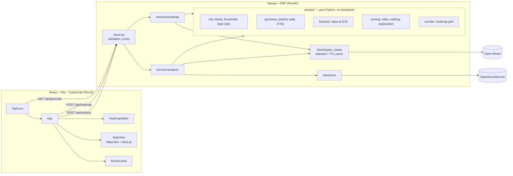

# Weather-Aware Truck Routing

Helps a truck driver choose the safest route: compares up to three routes by forecast
weather **at the time the truck actually reaches each point**, the load weight, and
travel time, then recommends one and explains why.

- **Live app:** https://weather-truck-routing-wewt.vercel.app
- **API:** https://weather-truck-routing-gules.vercel.app/api/health/
- **Walkthrough:** _TODO: Loom URL_


## What it does

1. Enter origin, destination, departure time, load weight and a checkpoint interval
   (10 / 25 / 50 mi).
2. The backend gets up to 3 truck routes from OpenRouteService (`driving-hgv` profile).
3. Each route is walked to place checkpoints; each checkpoint's **ETA** is interpolated
   from the router's per-step durations (slow city streets vs fast highway).
4. Open-Meteo's hourly forecast is read **at each ETA** (interpolated between hours).
5. Every checkpoint gets a risk level from the wind / rain / snow tables and the load
   rules; routes are scored in **miles** of road at each level and ranked.
6. The UI shows all routes, risk-coloured checkpoints with ETA tooltips, route cards
   with a "why this route" explanation, and a 0–48 h weather-risk heatmap slider.

## Architecture



**Layering.** `domain/` holds every business rule as plain functions and data with no
Django, HTTP or I/O, so it is tested exhaustively and quickly. `clients/` talk to the
third-party APIs and turn their JSON into domain objects. `services/` orchestrate one use
case each. `views.py` only validates input and maps errors to HTTP status codes.

### Key design decisions

| Decision | Why |
|---|---|
| Risk levels are an ordered `IntEnum`; thresholds are **data tables**; load rules are small composable functions that can only raise a level | The spec reads straight off the code; changing a threshold is a one-line data edit |
| Routes scored in **miles**, not checkpoint counts: each checkpoint owns the road between the midpoints to its neighbours | Results don't change just because the sampling interval changed |
| Ranking is a **sort key tuple** `(has_no_travel, severe_mi, high_mi, avg_risk, duration)` | It *is* the spec's priority list, so it can't drift from it; the explanation names the first criterion that differed from the runner-up |
| ETA per checkpoint from **per-step durations** | Constant-speed ETAs would query the wrong forecast hour on mixed city/highway trips |
| ETA past the forecast = **"Forecast unavailable"**, reported as unknown miles | Never silently scored as Low |
| Weather fetched in **one batched request** for all routes (points snapped to 0.1°, 10 min cache) | An analysis is 1–2 weather calls, not hundreds |
| Heatmap: **all 49 hourly frames in one response**, columnar (coords once, one value array per hour), gzipped | The slider never refetches; a Dallas→Denver corridor is ~6 KB |
| Frontend turns each frame into a tiny bitmap **once**; the slider only swaps a texture; the GPU smooths it | Slider stays fluid; the route/checkpoint layers aren't rebuilt per tick |
| Heatmap value = continuous **risk index** whose `floor()` always equals the checkpoint level | Heatmap shading and checkpoint colours can never disagree (tested over thousands of weather and load combinations) |
| Single-hue, colour-blind-validated risk palette, always paired with text | Risk order reads by lightness for every viewer; never colour-only |

## API

| Method | Path | Body / query | Returns |
|---|---|---|---|
| GET | `/api/health/` | – | `{status, routing_configured}` |
| GET | `/api/geocode/?q=Dall` | `q` ≥ 3 chars | `{results: [{label, lat, lon}]}` |
| POST | `/api/analyze/` | `{origin, destination, departure, load_lb, interval_mi}`; places are text or `{label, lat, lon}` | ranked routes, checkpoints, scores, explanation |
| POST | `/api/heatmap/` | `{paths: [[[lat, lon], …]], start, load_lb}` | `{start, hours, step_deg, lat[], lon[], frames[hour][cell]}` |

Errors: `400` invalid input (per-field messages), `422` e.g. address not found,
`502` upstream API failed, `503` routing key not configured.

## Run locally

Requirements: Python 3.9+ (3.12 recommended), Node 20+, a free
[OpenRouteService key](https://account.heigit.org/signup) (OpenRouteService is run by HeiGIT; the API lives at `api.heigit.org`). Open-Meteo needs no key.

```bash
# Backend
cd backend
python3 -m venv .venv && .venv/bin/pip install -r requirements-dev.txt
cp .env.example .env            # then set ORS_API_KEY
.venv/bin/python manage.py runserver        # http://localhost:8000/api/health/

# Frontend (second terminal)
cd frontend
cp .env.example .env.local      # defaults point at localhost:8000
npm install
npm run dev                     # http://localhost:5173
```

### Tests and checks

```bash
cd backend  && .venv/bin/pytest && .venv/bin/ruff check . && .venv/bin/black --check .
cd frontend && npm test && npm run typecheck && npm run format:check
```

The backend suite (200 tests) never touches the network: clients are tested against
recorded or hand-built API payloads (`backend/tests/fixtures/`), services against fakes.
CI runs both suites plus a production build on every push.

## Deployment

Both halves run on **Vercel's free Hobby plan** as two projects from this repo (no card).

| Project | Root directory | Framework | Environment variables |
|---|---|---|---|
| API | `backend` | Django (auto-detected from `manage.py`) | `DJANGO_SECRET_KEY`, `DJANGO_DEBUG=false`, `DJANGO_ALLOWED_HOSTS=.vercel.app`, `ORS_API_KEY`, `CORS_ALLOWED_ORIGINS=<frontend URL>` |
| Web | `frontend` | Vite | `VITE_API_BASE_URL=<API URL>` |

The API is stateless (no database), so it runs as a serverless function. The weather
cache is per instance, which is fine for a short TTL. [`render.yaml`](render.yaml) is kept
as an alternative for running the API as a long-lived server on Render.

## Assumptions


### Risk band boundaries
The spec's bands touch at their edges (e.g. rain 0.25 appears in both Moderate and High).
Bands are **lower-inclusive**: a value equal to a boundary belongs to the higher band.
`>` is used only where the spec writes `>`.

| Factor | Low | Moderate | High | Severe | No Travel |
|---|---|---|---|---|---|
| Wind (mph) | < 25 | [25, 35) | [35, 45) | [45, 55) | ≥ 55 |
| Rain (in/hr) | < 0.10 | [0.10, 0.25) | [0.25, 0.50) | [0.50, 1.00] | > 1.00 |
| Snow (in/hr) | < 0.5 | [0.5, 1.0) | [1.0, 2.0) | [2.0, 3.0] | > 3.0 |

Wind is a continuous forecast value, so "25–34" is read as [25, 35); 34.6 mph is Moderate.

### Load rules
- "> 30,000 lb" and "> 40,000 lb" are strict: exactly 30,000 lb at 45 mph stays Severe.
- Load rules can only raise a checkpoint's level, never lower it.
- Checkpoint level = max over wind, rain, snow and applicable load rules.

### Scoring and ranking
- Each checkpoint represents the road between the midpoints to its neighbours, so mile
  totals don't depend on the sampling interval.
- "Severe miles" includes No Travel miles. Any route with a No Travel checkpoint is ranked
  last regardless of other criteria.
- Average risk = mile-weighted mean of level values (Low=0 … No Travel=4).
- Comparisons round miles to 0.1 mi and average risk to 0.001 so float noise can't decide
  a ranking. Exact ties keep the routing API's order.
- Checkpoints whose ETA is beyond the forecast horizon are "forecast unavailable": reported
  as unknown miles and excluded from the average, never silently treated as Low.

### Routes and checkpoints
- Routes use the OpenRouteService `driving-hgv` (heavy goods vehicle) profile.
- The public ORS API only returns alternative routes for trips under ~100 km. For longer
  trips we request the main route, then detours through points offset perpendicular from
  the midpoint (12% then 25% of the trip length, left then right). Detours within 2% of an
  existing route on both distance and duration are discarded as duplicates. If no distinct
  detour exists, fewer than 3 routes are shown rather than fake ones.
- Checkpoints are placed at mile 0, every N miles, and at the destination.
- Checkpoint ETA = departure + elapsed time, where elapsed time is interpolated from the
  routing API's per-step durations (so slow city streets and fast highways are respected).
- Mile markers are scaled to the API's reported odometer distance.

### Weather
- Source: Open-Meteo hourly forecast (no key), requested in mph and inches, UTC, 7 days.
- Rain rate = `rain + showers` for the hour (liquid only; snow is scored separately).
  Open-Meteo hourly precipitation is the total over the preceding hour, so it is used
  directly as in/hr. `snowfall` is in inches when `precipitation_unit=inch`.
- Weather at a checkpoint is linearly interpolated between the two hourly values around
  its ETA. If the ETA is outside the forecast, or either value is missing, the checkpoint
  is "Forecast unavailable".
- Checkpoints are snapped to a 0.1° grid (~7 mi) before fetching; nearby checkpoints
  share a forecast. All routes' points go in one batched request (chunks of 100), and
  each grid cell is cached for `WEATHER_CACHE_TTL_SECONDS` (default 10 minutes).
- Departure must be between 1 hour ago and 5 days ahead, so the trip fits in the forecast.
- Load weight is accepted from 0 to 150,000 lb.
- If every route has a No Travel checkpoint, no route is recommended.

### Heatmap
- `POST /api/heatmap` (not GET): the client sends the route paths, which are too long
  for a query string. Body: `{paths: [[[lat, lon], ...], ...], start, load_lb}`.
- The corridor is every grid cell within 0.5° (~35 mi) of any route, with the east-west
  reach widened by latitude. The grid step (0.1° to 1°) is the finest that keeps the
  corridor at or under 250 cells. Open-Meteo counts each location as one API call, so
  this bounds usage per heatmap regardless of trip length.
- Values are a continuous risk index from 0 to 4: the cell's risk level plus how far it
  is through that level's band (e.g. 30 mph wind = 1.5). `floor(index)` always equals the
  checkpoint risk level for the same weather and load (tested over thousands of
  combinations), so heatmap shading and checkpoint colours never disagree.
- Frame 0 is the departure hour (rounded down); frames run hourly to +48 h. Hours past the
  forecast are `null`.
- Payload is columnar: cell lat/lon arrays once, then one value array per hour, gzipped.

## Notes on the specification

Implemented exactly as written; these are observations, not changes.

- **Overlapping band edges** (e.g. rain 0.25 in both Moderate and High) are resolved as
  lower-inclusive bands; see the table above. Every edge has a test.
- **Wind is sustained speed at 10 m**, as the spec's bands suggest. Gusts are often what
  tips trucks over; Open-Meteo provides `wind_gusts_10m`, so scoring gusts would be a
  small change if wanted.
- **Load rules raise risk for heavy loads in wind.** In practice, highway wind advisories
  usually target *light, high-profile* (empty) trailers, which are the easiest to blow
  over. The rules are data (`LOAD_RULES` in `domain/risk.py`), so a light-load rule could
  be added without touching the engine.
- **The ranking is strictly lexicographic**, so 0.1 Severe miles outweighs any amount of
  extra driving time. That's what the spec asks for; a tolerance band would be a
  one-line change to the sort key.
- **"Severe miles" depends on how a checkpoint maps to road.** Counting checkpoints would
  make the result depend on the 10/25/50 mi choice; weighting by road length doesn't.
- **3 routes:** the public ORS API only returns alternatives for trips under ~100 km, so
  longer trips use detour routes. If no genuinely different route exists, fewer routes
  are shown instead of near-duplicates.

## Project layout

```
backend/
  config/                 settings (all from env), urls, wsgi
  routing/
    domain/               risk, scoring, geometry, forecast, corridor (pure)
    clients/              ors.py, open_meteo.py
    services/             analysis.py, heatmap.py
    serializers.py        request validation
    views.py              endpoints
  tests/                  domain/, clients/, services/, api/, fixtures/
frontend/
  src/api/                typed client + response types
  src/lib/                risk palette, formatting, heatmap rasterising
  src/components/         TripForm, PlaceInput, RouteCards, MapView, HeatmapSlider, Legend
render.yaml               Render blueprint
.github/workflows/ci.yml  lint, type-check, tests, build
```
